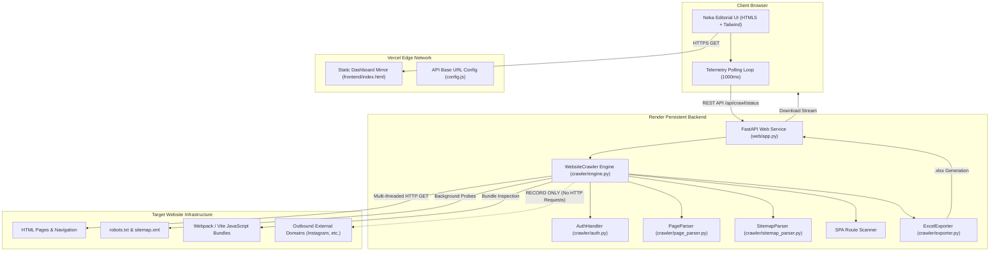

# Universal Website Crawler & Link Auditor — Complete Technical Documentation

> **Version:** 2.4.0  
> **Architecture:** Decoupled Split-Stack (FastAPI Persistent Worker Engine + Vanilla JS / Tailwind CDN Edge Frontend)  
> **Live Deployments:**  
> - **Frontend (Vercel Edge):** [https://website-crawler-virid.vercel.app/](https://website-crawler-virid.vercel.app/)  
> - **Backend API (Render Container):** [https://website-crawler-z8qf.onrender.com](https://website-crawler-z8qf.onrender.com)  

---

## Table of Contents

1. [Executive Overview & System Architecture](#1-executive-overview--system-architecture)
2. [Crawler Engine Mechanics & Concurrency Model](#2-crawler-engine-mechanics--concurrency-model)
3. [Multi-Source Link Discovery Engine](#3-multi-source-link-discovery-engine)
4. [Single Page Application (SPA) Route Discovery](#4-single-page-application-spa-route-discovery)
5. [Authentication Subsystem & Bot Protection Bypass](#5-authentication-subsystem--bot-protection-bypass)
6. [Complete REST API Reference](#6-complete-rest-api-reference)
7. [Excel (.xlsx) Report Generation Engine](#7-excel-xlsx-report-generation-engine)
8. [Frontend UI/UX Architecture & Neka Design System](#8-frontend-uiux-architecture--neka-design-system)
9. [Deployment & Operations Guide](#9-deployment--operations-guide)
10. [Local Development, CLI Mode & Testing](#10-local-development-cli-mode--testing)
11. [Troubleshooting & FAQ](#11-troubleshooting--faq)

---

## 1. Executive Overview & System Architecture

### 1.1 Purpose & Value Proposition
The **Universal Website Crawler & Link Auditor** is an enterprise-grade, multi-threaded web traversal engine and link intelligence tool designed to:
- Exhaustively catalog **every internal route and document** on any given domain (navigation links, footer URLs, blog posts, pagination, product pages, dynamic client-side routes, and XML sitemaps).
- Map all **outbound external links** (social links, partner websites, CDN assets, third-party services) **without ever crawling, visiting, or stressing external domains**.
- Detect and diagnose **broken links (4xx)**, **server crashes (5xx)**, **redirect loops/chains (3xx)**, and network latency bottlenecks.
- Audit **authenticated member portals** via browser session cookies (bypassing Cloudflare Turnstile, hCaptcha, Google reCAPTCHA, and 2FA) or automated form authentication.
- Automatically compile discoveries into a publication-grade, multi-tab **Excel (.xlsx)** audit workbook with executive dashboards, KPI cards, latency profiling, and auto-filters.

### 1.2 The Split-Stack Decoupled Architecture
Standard serverless platforms (e.g. Vercel, AWS Lambda) enforce a hard execution ceiling of 15 to 60 seconds. A deep website crawl spanning hundreds or thousands of pages cannot execute reliably inside a serverless lifecycle.

To solve this, the application uses a **Split-Stack Decoupled Architecture**:
- **Frontend Layer (Vercel CDN Edge)**: A lightweight, zero-build HTML5/Tailwind SPA with zero latency, global CDN caching, and dynamic connection to the backend.
- **Backend Worker Layer (Render Linux Container / VPS)**: A persistent Python FastAPI service managing non-blocking multi-threaded worker pools, background task execution, streaming telemetry, and in-memory session states.



---

## 2. Crawler Engine Mechanics & Concurrency Model

### 2.1 Breadth-First Search (BFS) Traversal
The crawl engine (`crawler/engine.py`) employs a thread-safe Breadth-First Search (BFS) queue backed by Python's `collections.deque` and synchronized via `threading.Lock`:
- **Queue Format**: `(url: str, parent_url: str, depth: int, discovery_source: str)`
- **Depth 0**: Seed URL provided by the user + Domain root URL + Authenticated landing destination.
- **Depth N + 1**: Every child URL extracted from pages at Depth N.
- **Deduplication**: Two atomic sets (`enqueued_urls` and `visited_urls`) guarantee that every unique normalized URL is queued and fetched exactly once.

### 2.2 Concurrency & Worker Execution
The crawler runs concurrent HTTP requests using Python's `concurrent.futures.ThreadPoolExecutor`:
- **Default Worker Concurrency**: 6 workers (configurable between 1 and 12).
- **HTTP Adapter Connection Pool**: Pooled `urllib3` connection manager configured with:
  ```python
  adapter = HTTPAdapter(
      max_retries=Retry(
          total=3,
          backoff_factor=1,
          status_forcelist=[429, 500, 502, 503, 504],
          connect=3,
          read=3,
          raise_on_status=False
      ),
      pool_connections=24,
      pool_maxsize=36
  )
  ```
- **Non-blocking Event Loop**: Crawl lifecycle is controlled by `threading.Event`:
  - `_stop_event`: Immediate graceful abort.
  - `_pause_event`: Halts workers mid-crawl without losing queue items or discovered state.

### 2.3 URL Canonicalization & Normalization (`crawler/url_utils.py`)
To prevent infinite crawl loops caused by URL variations, every URL undergoes canonical normalization before reaching the queue:
1. **Scheme Validation**: Strictly allows `http` and `https`. Ignores non-HTTP protocols (`mailto:`, `tel:`, `javascript:`, `whatsapp:`, `data:`, `sms:`).
2. **Relative URL Resolution**: Resolves relative paths (`/about`, `../contact`, `services/`) against the originating page base URL using `urllib.parse.urljoin`.
3. **Fragment Stripping**: Discards hash anchors (`#team`, `#overview`) so identical pages with different anchors do not cause duplicate requests.
4. **Tracking Parameter Stripping**: Automatically purges marketing and analytics parameters:
   `utm_source`, `utm_medium`, `utm_campaign`, `utm_term`, `utm_content`, `fbclid`, `gclid`, `msclkid`, `dclid`, `_ga`, `_gl`, `ref`, `replytocom`.
5. **Path Normalization**: Collapses redundant slashes (e.g. `//path///sub` -> `/path/sub`), strips trailing slashes on non-root paths, and sorts remaining valid query parameters.

### 2.4 Domain Boundary Enforcement
The crawler strictly enforces domain containment:
- **Base Domain Match**: Extracts the root hostname (e.g., `example.com` from `https://www.example.com/page`).
- **Subdomain Control**: Subdomains (e.g., `blog.example.com`, `shop.example.com`) are treated as external links unless the `--subdomains` flag or `chkSubdomains` option is explicitly enabled.
- **Outbound Link Boundary**: Any URL resolving to a different host is categorized as **External**.

### 2.5 Binary & Static Asset Handling (Fast HEAD Inspection)
Non-HTML static binary files (`.pdf`, `.zip`, `.png`, `.jpg`, `.mp4`, `.docx`, etc.) are recognized via `EXCLUDED_EXTENSIONS`. When encountered:
1. The crawler skips full HTML extraction.
2. A lightweight `HEAD` request is issued to verify asset existence, record the HTTP status (200, 404), and measure latency.
3. The asset is labeled as `[Asset] filename.ext` in the results table without spending memory parsing binary content.

---

## 3. Multi-Source Link Discovery Engine

Discovery does not rely solely on standard `<a href="...">` tags. The crawler incorporates four distinct discovery layers:

### 3.1 Comprehensive HTML Parsing (`crawler/page_parser.py`)
`PageParser` uses `BeautifulSoup` with `html.parser` (or `lxml`) to extract links across six HTML surfaces:
1. **Standard Anchors**: `<a href="...">` — extracts target URL and anchor text / aria-labels.
2. **Header Canonical & Alternate Links**: `<link rel="canonical" href="...">`, `<link rel="alternate" href="...">`, `<link rel="next|prev" href="...">`.
3. **Dynamic Data Attributes**: Elements with `data-href`, `data-url`, `data-link`, or `data-target`.
4. **Form Actions**: `<form action="...">` (discovers search endpoints and internal landing paths).
5. **Client-Side Area Maps**: `<area href="...">` image maps with `alt` labels.
6. **Inline Script Path Declarations**: Regex scanner extracting internal paths declared in inline JavaScript:
   ```regex
   (?:href|url|path|location|window\.location)\s*[:=]\s*["'](/[^"'\s<>#]+)["']
   ```

### 3.2 XML Sitemap Auto-Discovery (`crawler/sitemap_parser.py`)
In parallel with HTML parsing, a dedicated background daemon probes:
- `robots.txt` for explicit `Sitemap:` directives.
- Standard sitemap endpoints: `/sitemap.xml`, `/sitemap_index.xml`, `/wp-sitemap.xml`, `/sitemap/sitemap.xml`.
- **Recursive Index Handling**: Automatically parses parent sitemap index files and follows child XML sitemaps up to 8 levels deep.
- Queues newly discovered URLs directly into the live crawl queue with discovery source labeled as `"XML Sitemap"`.

### 3.3 Outbound External Links Collection (Strict Non-Crawling Guarantee)
When an external link is encountered on the target website:
- **Captured Metadata**:
  - Full Destination URL (e.g. `https://www.instagram.com/company/`)
  - Destination Domain (e.g. `instagram.com`)
  - Parent Referrer Page (the internal URL where the link was found)
  - Anchor Text / Accessibility Label (e.g. `"Follow us on Instagram"`)
  - Discovery Source (`"Page Link"`, `"Data Attribute"`, `"Area Map"`)
- **Zero-Follow Principle**: External links are **never added to the crawl queue and never requested**. They are stored in `external_links` dictionary and exported to Tab 3 of the Excel report.

---

## 4. Single Page Application (SPA) Route Discovery

Modern JavaScript web applications built with **React Router, Next.js, Vue Router, or Vite** frequently omit traditional `<a href>` tags in server-rendered HTML. To index these applications, the crawler features two complementary engines:

### 4.1 Client-Side JavaScript Bundle Route Scanner (`crawler/engine.py`)
When **SPA Mode** is enabled (`enable_spa_mode=True`):
1. The engine scans the HTML for first-party JavaScript bundles (`<script src="/_next/static/chunks/..." >`, `/assets/index-*.js`, `/main.*.js`).
2. Third-party trackers (Google Analytics, Sentry, Facebook Pixel, Intercom) are strictly filtered out.
3. The engine fetches first-party JS bundles and executes high-precision regex extraction for route definitions:
   ```regex
   (?:path|to|href)\s*:\s*["'](/[^"'\s#?]+)["']
   ```
4. Discovered paths (e.g. `/dashboard`, `/account/billing`, `/projects/view`) are normalized against the domain origin, filtered against excluded patterns, and queued into the crawler.

### 4.2 Dynamic Headless Browser Engine (`crawler/dynamic_extractor.py`)
For pages requiring DOM execution, hydration, or scroll-triggered lazy loading:
- Powered by **Selenium Headless Chrome** (`--headless=new`).
- Automatically scrolls down the page in increments (`window.scrollTo`) to trigger lazy-loaded image lists, pagination, and dynamic components.
- Extracts fully hydrated links directly from the live browser DOM (`document.querySelectorAll('a[href]')`).
- Operates selectively (only when HTML parser encounters 0 links on an SPA root) to conserve CPU and memory.

---

## 5. Authentication Subsystem & Bot Protection Bypass

The authentication module (`crawler/auth.py`) enables crawling private member areas, intranets, SaaS dashboards, and portal routes.

```
       [Target Website Input]
                 │
      Does it require auth?
        (POST /api/auth/inspect)
                 │
       ┌─────────┴─────────┐
       ▼                   ▼
 [Protected / Login]    [Public]
       │                   │
   Bot Protected?          ▼
(Turnstile / CAPTCHA)  Standard Crawl
   ┌───┴───┐
   ▼       ▼
 [YES]    [NO]
   │       │
   │       ├─ Option B: Username / Password (HTTP Form / Headless Chrome)
   │
   ▼
Option A: Session Cookie Injection (Recommended)
   - User copies cookie string or JSON from browser DevTools / Cookie-Editor
   - Injected directly into requests.Session
   - Bypasses Cloudflare Turnstile, hCaptcha, Google reCAPTCHA, and 2FA
   - Crawler explores authenticated internal dashboard links
```

### 5.1 Option A: Session Cookie Injection (Highest Reliability)
- **Why It Matters**: Cloudflare Turnstile, Cloudflare Challenge (`cf-challenge`), hCaptcha, and AWS WAF block automated username/password bots. Session cookies bypass bot challenges completely because the user already verified their identity in their genuine browser.
- **Supported Formats**:
  - Standard HTTP header string: `session_id=abc123xyz; auth_token=jwt.token.here; uid=42`
  - JSON format exported by browser extensions (Cookie-Editor, EditThisCookie):
    ```json
    [{"name": "session_id", "value": "abc123xyz", "domain": "example.com"}]
    ```
- **Execution**: The crawler injects cookies into `requests.Session.cookies`, sets the `Cookie` request header, probes the start URL and common member paths (`/dashboard`, `/account`), and feeds member links into the queue.

### 5.2 Option B: Automated Form Login
- **HTTP POST Submission**: Automatically inspects the login page, locates form inputs (`username`, `email`, `password`), extracts hidden CSRF tokens (`_token`, `csrf_token`), and submits credentials via HTTP POST.
- **Headless Chrome Fallback**: For client-side login forms (React/Next.js/Auth0), launches headless Chrome, enters credentials into input selectors, clicks the submit button, waits for redirection or auth tokens, and transfers resulting cookies to the crawl session.

### 5.3 Pre-flight Login Inspection (`POST /api/auth/inspect`)
The frontend automatically inspects URLs before crawling:
- Detects HTTP 401 Unauthorized or 403 Forbidden.
- Detects HTTP 302/307 redirects to login paths (`/login`, `/signin`, `/auth`).
- Detects Cloudflare Turnstile scripts (`challenges.cloudflare.com`, `cf-challenge`) and advises the user to use Option A (Session Cookies).

---

## 6. Complete REST API Reference

The backend API is served by FastAPI on port 8000 (local) or via environment `$PORT` on Render.

### 6.1 Endpoints Summary

| Method | Endpoint | Description |
|---|---|---|
| `GET` | `/` | Serves the single-page dashboard HTML |
| `GET` | `/healthz` | Health check endpoint for uptime monitors and Render keep-alive |
| `GET` | `/api/environment` | Returns deployment environment (`Render`, `Vercel`, or `Local`) |
| `POST` | `/api/auth/inspect` | Pre-flight URL inspection for login portals & CAPTCHA detection |
| `POST` | `/api/crawl/start` | Initiates an asynchronous crawl in a background thread (`screenshots: false` to skip evidence capture) |
| `GET` | `/api/crawl/status?since=N&ext_since=M` | Real-time telemetry plus every new result after cursor `N` (`new_results`, `next_since`); `phase` is `crawling` → `analyzing` → `done` |
| `GET` | `/api/crawl/issues` | All 4xx / 5xx / network issues with diagnosis (title, causes, fix, severity), link position and screenshot URLs |
| `GET` | `/api/crawl/evidence/{name}` | Serves one captured screenshot (`.jpg`) |
| `GET` | `/api/crawl/report/excel?category=…` | Excel for one scope: `all`, `2xx`, `3xx`, `4xx`, `5xx`, `error`, `issues`, `external` |
| `GET` | `/api/crawl/report/pdf` | Visual PDF issue report (summary page + one card per issue with screenshots) |
| `POST` | `/api/crawl/pause` | Pauses active worker threads |
| `POST` | `/api/crawl/resume` | Resumes paused worker threads |
| `POST` | `/api/crawl/stop` | Stops crawling; during the `analyzing` phase it skips the remaining screenshots. Reports are still generated |
| `POST` | `/api/crawl/reset` | Clears completed crawl session and resets engine to idle state |
| `POST` | `/api/crawl/direct` | Synchronous crawl endpoint optimized for 60s serverless environments |
| `GET` | `/api/crawl/export` | Downloads the latest generated Excel `.xlsx` workbook |
| `GET` | `/api/crawl/download/{filename}` | Downloads a generated report by name (only `crawl_*.xlsx` / `crawl_*.pdf`) |

#### Issue diagnosis & visual evidence
- Every internal result carries `category` (`2xx`, `3xx`, `4xx`, `5xx`, `error`; final status wins, so `301 → 404` is `4xx`) and the element on the parent page that linked to it: `anchor_text`, `link_region` (Header, Navigation menu, Main content, Footer, Sidebar, XML sitemap…), `link_selector` (CSS path) and `link_html`.
- `crawler/issues.py` maps each failure to a plain-language title, likely causes and a fix, with context hints (Cloudflare blocks, sitemap-only URLs, capital letters in paths, redirect chains ending in errors).
- After the crawl, `crawler/evidence.py` (Selenium + Chrome) opens each parent page, spotlights the broken link, records its position, and screenshots the broken page itself. It covers the 25 most severe issues (`CRAWLER_MAX_SCREENSHOTS`). Without Selenium/Chrome the PDF shows a page-position sketch instead.

---

### 6.2 Detailed Endpoint Specifications

#### `POST /api/crawl/start`
Starts a background crawl session.

**Request Payload (`application/json`):**
```json
{
  "url": "https://example.com",
  "max_urls": 0,
  "max_depth": 50,
  "concurrency": 6,
  "timeout": 15,
  "use_sitemaps": true,
  "collect_external": true,
  "use_dynamic_js": true,
  "enable_spa_mode": false,
  "delay": 0.0,
  "subdomains": false,
  "verify_ssl": false,
  "force": false,
  "auth": {
    "enabled": true,
    "auth_type": "cookies",
    "cookies": "session=xyz123; user_id=99",
    "username": "",
    "password": "",
    "login_url": ""
  }
}
```

**Response (`200 OK`):**
```json
{
  "status": "started",
  "target": "https://example.com",
  "output_file": "crawl_example.com_20261021_153000.xlsx"
}
```

---

#### `GET /api/crawl/status`
Polls real-time telemetry for UI rendering.

**Response (`200 OK`):**
```json
{
  "status": "running",
  "stats": {
    "status": "running",
    "elapsed_seconds": 14.2,
    "total_discovered": 142,
    "total_crawled": 58,
    "queue_size": 84,
    "status_2xx": 54,
    "status_3xx": 2,
    "status_4xx": 1,
    "status_5xx": 1,
    "status_err": 0,
    "failed_count": 2,
    "auth_required_count": 0,
    "total_external": 37,
    "unique_external_domains": 8,
    "start_url": "https://example.com",
    "auth_used": true,
    "auth_status": "Loaded 2 session cookies",
    "auth_error": null,
    "limitations": []
  },
  "results_count": 58,
  "external_count": 37,
  "recent_results": [
    {
      "page_title": "About Our Team",
      "url": "https://example.com/about",
      "parent_url": "https://example.com/",
      "http_status": "200 OK",
      "status_code": 200,
      "redirect_destination": "-",
      "depth": 1,
      "discovery_source": "Page Navigation",
      "content_type": "text/html; charset=UTF-8",
      "response_time_ms": 142,
      "error_message": null
    }
  ],
  "recent_external": [
    {
      "url": "https://twitter.com/company",
      "domain": "twitter.com",
      "parent_url": "https://example.com/",
      "anchor_text": "Follow on Twitter",
      "discovery_source": "Page Link",
      "validation_status": "Recorded (Not Followed)"
    }
  ],
  "logs": [
    "[15:30:01] Starting automatic crawl for: https://example.com (Workers: 6)",
    "[15:30:02] Probing robots.txt and XML sitemaps in background..."
  ],
  "export_ready": false,
  "export_file": "crawl_example.com_20261021_153000.xlsx"
}
```

---

#### `POST /api/auth/inspect`
Inspects a target website before initiating a crawl.

**Request Payload:**
```json
{
  "url": "https://example.com/login"
}
```

**Response (`200 OK`):**
```json
{
  "requires_auth": true,
  "reason": "Login portal with Cloudflare Turnstile / CAPTCHA detected (Session Cookies recommended)",
  "login_url": "https://example.com/login",
  "auth_type": "cookies",
  "has_captcha": true
}
```

---

## 7. Excel (.xlsx) Report Generation Engine

The export subsystem (`crawler/exporter.py`) generates an executive-styled workbook using `openpyxl`.

### 7.1 Worksheets Breakdown

```
┌────────────────────────────────────────────────────────────────────────┐
│                        CRAWL EXCEL WORKBOOK                            │
├───────────────┬───────────────┬───────────────┬──────────────┬─────────┤
│ Tab 1:        │ Tab 2:        │ Tab 3:        │ Tab 4:       │ Tab 5:  │
│ Crawl Summary │ Internal URLs │ External Links│ Broken & Err │ Redirect│
└───────────────┴───────────────┴───────────────┴──────────────┴─────────┘
```

1. **Tab 1: Crawl Summary (Executive Audit Dashboard)**:
   - Navy Header (`#0F172A`) with high-contrast bold white typography.
   - Key audit metadata: Target URL, Crawl Timestamp, Completion Status, Authentication method used.
   - Quantitative KPI Table: Total internal discovered vs crawled, 2xx success count and percentage, 3xx redirect count, 4xx broken links, 5xx server errors, total external outbound links, unique external domains count, total crawl duration.
   - Identified limitations and security barriers noted during crawl.

2. **Tab 2: Internal URLs**:
   - Complete inventory of all crawled internal pages.
   - Columns: `Index`, `Page Title`, `Discovered Internal URL`, `Parent Page (Referrer)`, `HTTP Status`, `Status Code`, `Redirect Destination`, `Depth`, `Discovery Source`, `Content Type`, `Latency (ms)`, `Error Notes`.
   - Dynamic status row fills: Soft Green (`#DEF7EC`) for 2xx, Amber Yellow (`#FEF08A`) for 3xx, Soft Red (`#FDE8E8`) for 4xx, Maroon (`#FFE4E6`) for 5xx/errors.

3. **Tab 3: External Links**:
   - Outbound external links discovered on the target website.
   - Purple Header (`#4F46E5`).
   - Columns: `Index`, `External Destination URL`, `External Domain`, `Parent Page (Found On)`, `Anchor Text / Label`, `Validation Status`, `Discovery Source`.
   - Explicit validation status: `"Recorded (Not Followed)"`.

4. **Tab 4: Broken Links & Errors**:
   - Filtered view containing only 4xx client errors, 5xx server errors, and network connection timeouts.
   - Red Header (`#991B1B`).
   - Direct parent referrer column allows immediate remediation of dead links.

5. **Tab 5: Redirects (3xx)**:
   - Amber Header (`#D97706`).
   - Maps original requested URLs directly to final destination URLs for SEO audit.

### 7.2 Styling & Formatting Standards
- **Font**: Segoe UI throughout the workbook.
- **Header Heights**: 28pt for headers, 20pt for data rows.
- **Frozen Panes**: Header row (`A2`) frozen on all sheets for seamless scrolling.
- **Auto-Filters**: Native Excel auto-filter enabled across all data columns.
- **Auto-Fitted Columns**: Column widths calculated dynamically based on longest cell content (capped at 65 characters to prevent oversized columns).

---

## 8. Frontend UI/UX Architecture & Neka Design System

The frontend is an ultra-fast, zero-build single page application hosted on Vercel Edge (`frontend/index.html`) and mirrored locally (`index.html` and `web/static/index.html`).

### 8.1 The Neka Warm Light Editorial Design System
Inspired by modern editorial dashboard design:
- **Base Background**: Warm off-white (`#FAF9F5`).
- **Surface Cards**: Pure white (`#FFFFFF`) with subtle warm-neutral borders (`#EBE7DE`) and soft elevated shadows (`shadow-[0_2px_8px_rgba(24,28,26,0.04)]`).
- **Primary Accent**: Forest Sage Green (`#244B30`) with soft sage hover states (`#1B3824`).
- **Secondary Accent**: Warm Amber (`#C2812E`).
- **Typography**: Inter / Segoe UI with charcoal headers (`#181C1A`) and muted slate descriptions (`#656E66`).

### 8.2 Component Hierarchy & Structure

```
┌────────────────────────────────────────────────────────────────────────┐
│  Navbar: Brand Logo | Backend Status Pill | Live Ping Indicator        │
├────────────────────────────────────────────────────────────────────────┤
│  Search Section: [ URL Input ] [ Start Crawling ]                      │
│  Advanced Settings (Collapsible): [ Auth Tabs ] [ SPA ] [ Limits ]     │
├────────────────────────────────────────────────────────────────────────┤
│  Live Progress Panel: Bar | Queue | Active | Pause | Stop | Reset      │
├────────────────────────────────────────────────────────────────────────┤
│  4 HTTP Status Cards:                                                  │
│  [ 2XX Success ]   [ 3XX Redirects ]   [ 4XX Client ]   [ 5XX Server ] │
├────────────────────────────────────────────────────────────────────────┤
│  Results Dashboard:                                                    │
│  Tabs: [ Internal URLs ] [ External Links ] [ Broken/Errors ] [ Logs ] │
│  Filter Bar: [ Search URL / Title ] [ Download Excel (.xlsx) ]         │
│  Responsive High-Density Table with Sticky Header                      │
└────────────────────────────────────────────────────────────────────────┘
```

### 8.3 Scroll Animations & Interactions
- **Lightweight CSS Transitions**: Fade-in and upward slide effects (`opacity-0 translate-y-3` transitioning to `opacity-100 translate-y-0`).
- **Intersection Observer**: Observes `.reveal-on-scroll` elements and triggers entrance animations as sections scroll into view.
- **Staggered Reveals**: Status cards animate in with staggered timing delays (`stagger-1` through `stagger-4`).
- **Accessibility Compliance**: Fully honors `prefers-reduced-motion` by disabling CSS animations when requested by system settings.

### 8.4 Synchronization Rule for Developers
Any modifications made to the frontend markup or JavaScript logic in `index.html` **must always be mirrored** to both:
- `frontend/index.html` (Vercel deployment bundle)
- `web/static/index.html` (FastAPI static fallback bundle)

PowerShell sync command:
```powershell
Copy-Item index.html frontend\index.html -Force; Copy-Item index.html web\static\index.html -Force
```

---

## 9. Deployment & Operations Guide

### 9.1 Render Backend Setup (Persistent Python Web Service)
1. Log in to [render.com](https://render.com) and click **New + > Web Service**.
2. Connect your repository (`website_crawler`).
3. Configure the service:
   - **Environment**: `Python 3`
   - **Branch**: `main`
   - **Build Command**: `pip install -r requirements.txt`
   - **Start Command**: `uvicorn web.app:app --host 0.0.0.0 --port $PORT`
   - **Instance Type**: Free or Starter
4. Deploy the service and copy your public URL:
   `https://website-crawler-z8qf.onrender.com`
5. Verify health:
   `GET https://website-crawler-z8qf.onrender.com/healthz` -> `{"status": "ok"}`

### 9.2 Vercel Frontend Setup (Static Edge CDN)
1. Log in to [vercel.com](https://vercel.com) and click **Add New... > Project**.
2. Select your repository (`website_crawler`).
3. Configure Project Settings:
   - **Framework Preset**: `Other`
   - **Root Directory**: `./` (or `frontend`)
4. Deploy the project.

### 9.3 Linking Frontend to Backend
The frontend resolves the backend URL through a 3-tier cascade:
1. **User Override (`localStorage`)**: Entered via the **Backend Status** modal in the UI navbar.
2. **Global Config Variable (`window.CRAWLER_API_BASE_URL`)**: Set inside `config.js` and `frontend/config.js`:
   ```javascript
   window.CRAWLER_API_BASE_URL = "https://website-crawler-z8qf.onrender.com";
   ```
3. **Same-Origin Fallback**: `window.location.origin` (used when running locally on `localhost:8000`).

---

## 10. Local Development, CLI Mode & Testing

### 10.1 Local Installation
```bash
# Clone the repository
git clone https://github.com/your-username/website_crawler.git
cd website_crawler

# Create and activate virtual environment
python -m venv venv
# On Windows:
venv\Scripts\activate
# On Linux/macOS:
source venv/bin/activate

# Install dependencies
pip install -r requirements.txt
```

### 10.2 Running the Web UI Locally
```bash
python run.py
```
Open your browser at `http://127.0.0.1:8000`. The frontend automatically binds to the local FastAPI backend.

### 10.3 Running the Command Line Interface (CLI)
The CLI allows headless automation, cron jobs, and terminal debugging without launching a web browser.

**Standard Crawl:**
```bash
python run.py --cli --url https://example.com/
```

**Advanced Crawl with Options:**
```bash
python run.py --cli --url https://example.com/ --threads 10 --max-urls 500 --output report.xlsx
```

**CLI Flags:**
- `url`: Target URL to crawl.
- `-o`, `--output`: Path to generated Excel `.xlsx` file.
- `-m`, `--max-urls`: Maximum URLs to discover/crawl (`0` = unlimited).
- `-d`, `--max-depth`: Maximum recursion depth (default: 10).
- `-t`, `--threads`: Concurrent worker threads (default: 8).
- `--no-sitemap`: Disables XML sitemap probing.
- `--no-external`: Disables collecting outbound external links.
- `--dynamic`: Enables Selenium Headless Chrome for dynamic JavaScript links.
- `--delay`: Adds polite pause in seconds between requests per thread.
- `--subdomains`: Includes subdomains within internal domain boundary.
- `--verify-ssl`: Enforces strict SSL verification.

---

## 11. Troubleshooting & FAQ

### Q1: The backend displays "Server Sleeping" or requests take 40 seconds to start.
- **Cause**: Render's Free tier spins down web services after 15 minutes of inactivity.
- **Fix**: The frontend includes an automatic wake-up handler that pings `/healthz`. Once pinged, the container boots in ~30–50 seconds and stays active for all subsequent requests.

### Q2: Crawl encounters Cloudflare Turnstile or CAPTCHA on login.
- **Cause**: Cloudflare flags automated browser drivers (even headless Chrome).
- **Fix**: Switch to **Option A (Session Cookies)** in the Authentication tab:
  1. Log in to the target website in your normal desktop browser.
  2. Open DevTools (`F12`) > **Application** > **Cookies**, or use a browser extension like Cookie-Editor.
  3. Copy your cookies and paste them into the session cookies input.
  4. The crawler injects the valid authenticated session directly, bypassing all bot challenges.

### Q3: Some client-side routes on a React/Next.js website are not found.
- **Fix**: Expand **Advanced Settings** and enable **SPA Route Discovery Mode** (`enable_spa_mode=True`). This triggers the bundle scanner to inspect JavaScript webpack and vite chunks for route strings.

### Q4: Crawl queue finishes immediately after 1 page.
- **Cause**: The website may rely entirely on client-side JavaScript rendering without standard `<a href>` tags, or the server blocked requests with a 403 Forbidden.
- **Fix**: Enable **SPA Route Discovery** or **Dynamic JS Browser**, and inspect whether the target website requires session cookies.

---

*Universal Website Link Crawler & Link Auditor — Engineered for speed, domain isolation, and comprehensive web auditing.*
