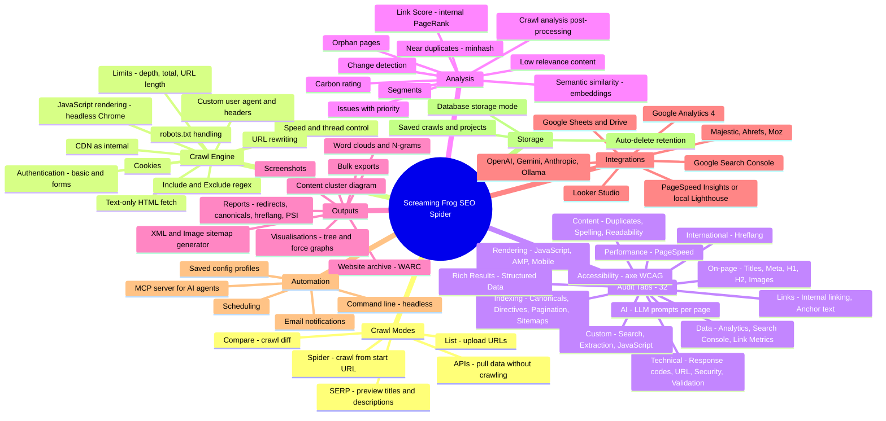
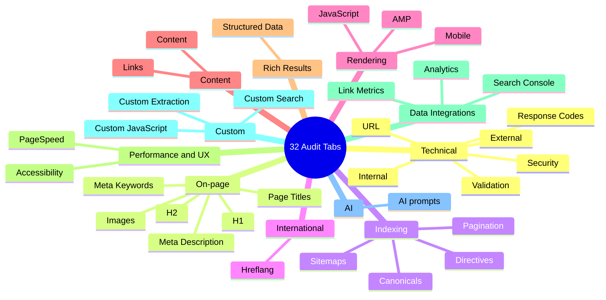
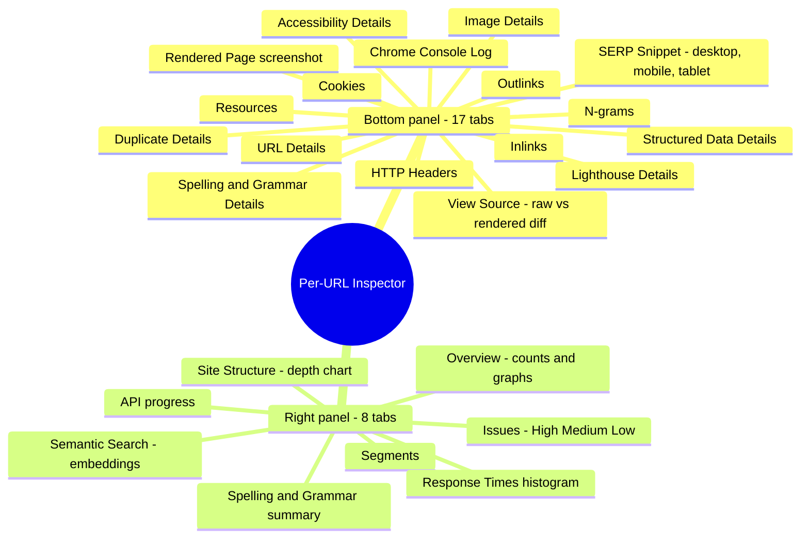
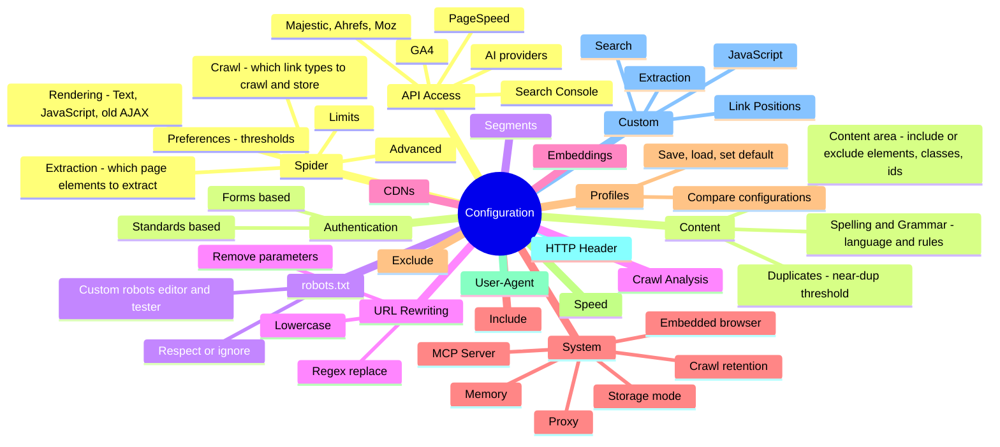
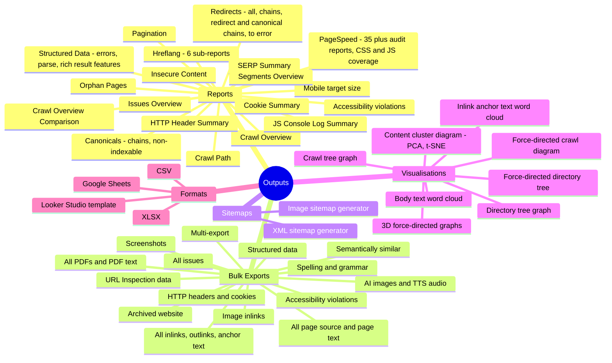
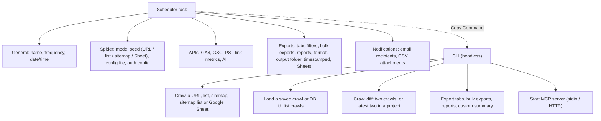

# Screaming Frog SEO Spider: Reverse-Engineered Feature Map

> **Last compared with ARACHNIX 1.0 on 2026-10-28.** Sections 12.2, 12.3 and 13 say what ARACHNIX has. The other sections describe Screaming Frog.

> **Target:** Screaming Frog SEO Spider **v24.3** (build `3a23d41`), installed at `C:\Program Files (x86)\Screaming Frog SEO Spider`
> **Date:** 2026-10-27
> **Purpose:** Research input for building my own SEO tool. Every feature is listed so I can choose what to build.
> **Graphs:** written in Mermaid. They render in GitHub, VS Code (with a Mermaid extension), Obsidian and Notion.

---

## 0. How this was reverse-engineered (REA method)

No bytecode was decompiled. Everything here comes from what the app ships in readable form, plus its public website.

| # | Evidence source | What it revealed |
|---|---|---|
| 1 | `ScreamingFrogSEOSpider.jar` → `META-INF/MANIFEST.MF` | Version, main class, and **~330 bundled libraries**, which show the whole tech stack (§10) |
| 2 | `translations/SeoSpider_en.properties` (6,495 UI strings) | **Every** tab, filter, setting, report, export, CLI option and dialog label |
| 3 | `ai_presets/*`, `javascript_snippets/*` | Built-in AI prompt presets and the custom-JS snippet library |
| 4 | `structured_data/ttl/*.ttl` (31 files) + `schemaorg-all-http.nt` | Validates structured data against Google rich-result SHACL shapes plus the full schema.org vocabulary |
| 5 | `lighthouse/*.mjs`, `axe-core/`, `amp/validator_wasm.js` | Runs Lighthouse locally, uses axe-core for accessibility, and the official AMP validator |
| 6 | `visualisations/*` (d3, 3d-force-graph) | How the site graphs are drawn |
| 7 | `~/.ScreamingFrogSEOSpider/tabPrefs_*` | Exact tab order for each mode (Spider, List, SERP, Compare, API) |
| 8 | `screamingfrog.co.uk/seo-spider/` | Free vs paid split and pricing |

---

## 1. Size of the product (by the numbers)

| Metric | Count |
|---|---|
| Crawl modes | **5** (Spider, List, SERP, Compare, APIs) |
| Main audit tabs | **32** |
| Filters inside those tabs | **~267** + 19 validation/mobile checks |
| Accessibility rules (axe-core / WCAG) | **96** |
| PageSpeed / Lighthouse issues | **19**, plus Request Errors, 57 metric columns and ~35 per-audit reports |
| Per-URL detail panels (bottom pane) | **17** |
| Overview side panels | **8** |
| Report menu entries | **~92** |
| Bulk export entries | **~41** |
| Google rich-result types validated | **31** |
| Spelling/grammar language packs | **34** |
| AI providers | **4** (OpenAI, Gemini, Anthropic, Ollama) |
| UI languages | 5 (EN, DE, ES, FR, IT) |

---

## 2. Master feature graph

---

## 3. How it works: the crawl pipeline

Reconstructed from the configuration labels and libraries. This is the architecture to copy.

```mermaid
flowchart LR
    subgraph IN["1 - Input"]
        A1["Start URL (Spider)"]
        A2["URL list / sitemap / Google Sheet (List)"]
        A3["Two saved crawls (Compare)"]
    end

    subgraph FRONTIER["2 - Frontier and Rules"]
        B1["URL queue (BFS by depth)"]
        B2["robots.txt + custom robots"]
        B3["Include / Exclude regex"]
        B4["URL rewriting + param removal"]
        B5["Limits: total, depth, per-depth, query strings"]
        B6["Speed: threads, URL/s"]
    end

    subgraph FETCH["3 - Fetch"]
        C1["HTTP client (UA, headers, cookies, auth, proxy)"]
        C2["Redirect follower (3xx / meta / JS / HTTP refresh)"]
        C3["Headless Chrome render (JS mode)"]
        C4["Screenshots + console log + WARC archive"]
    end

    subgraph PARSE["4 - Parse and Extract"]
        D1["HTML parser (raw + rendered)"]
        D2["Links + anchor text + link position"]
        D3["Titles, meta, headings, canonicals, hreflang, directives"]
        D4["Structured data: JSON-LD, Microdata, RDFa"]
        D5["Custom search / XPath / CSS / regex / JS"]
        D6["PDF text, images, resources"]
    end

    subgraph ENRICH["5 - Per-page enrichment"]
        E1["Spelling and grammar"]
        E2["Readability, word count, text-to-code ratio, hash"]
        E3["Accessibility (axe-core)"]
        E4["Lighthouse / PSI"]
        E5["AI prompts + embeddings"]
        E6["GA4 / GSC / link metric APIs"]
    end

    subgraph STORE["6 - Store"]
        F1[("Embedded DB (Derby / SQLite)")]
    end

    subgraph ANALYSE["7 - Crawl Analysis (post-crawl)"]
        G1["Link Score"]
        G2["Orphans vs sitemaps / GA / GSC"]
        G3["Hreflang + pagination + canonical chains"]
        G4["Near-duplicate + semantic similarity"]
        G5["Issue engine: priority + type"]
    end

    subgraph OUT["8 - Output"]
        H1["32 tabs + filters UI"]
        H2["Reports + bulk exports (CSV, XLSX, Sheets)"]
        H3["Visualisations"]
        H4["Sitemaps generator"]
        H5["Email / schedule / CLI / MCP"]
    end

    IN --> FRONTIER --> FETCH --> PARSE --> ENRICH --> STORE --> ANALYSE --> OUT
    PARSE -- "new links" --> B1
```

---

## 4. Audit tabs and filters (the core product)

### 4.1 Tab graph

### 4.2 Every filter, by tab

`{X}` = threshold you can configure in Preferences.

#### Technical
| Tab | Filters |
|---|---|
| **Internal** | All · HTML · JavaScript · CSS · Images · Media · Fonts · XML · PDF · Plugins · Other · Unknown (plus a directory **tree view**) |
| **External** | Same content-type split as Internal |
| **Response Codes** | Blocked by robots.txt · Blocked Resource · No Response · 2xx · 3xx · Redirect (JavaScript) · Redirect (Meta Refresh) · Redirect (HTTP Refresh) · 4xx · 5xx · All Errors. Each comes as Internal and External variants, plus **Internal Redirect Chain** and **Internal Redirect Loop** |
| **Security** | HTTP URLs · HTTPS URLs · Mixed Content · Form URL Insecure · Form on HTTP URL · Unsafe Cross-Origin Links · Missing HSTS · Bad Content Type · Missing X-Content-Type-Options · Missing X-Frame-Options · Protocol-Relative Resource Links · Missing CSP · Missing Secure Referrer-Policy |
| **URL** | Non-ASCII · Underscores · Uppercase · Parameters · Over {X} chars · Multiple Slashes · Repetitive Path · Contains Space · Internal Search · GA Tracking Params · Broken Bookmark (#fragment) |
| **Validation** | Invalid elements in head · head not first in html · Missing head · Multiple heads · Missing body · Multiple bodies · Body before html · HTML doc over 15MB / {X}MB · Resource over 15MB / {X}MB · **High Carbon Rating** |

#### On-page
| Tab | Filters |
|---|---|
| **Page Titles** | Missing · Duplicate · Over/Below {X} chars · **Over/Below {X} pixels** · Same as H1 · Multiple · Outside head |
| **Meta Description** | Missing · Duplicate · Over/Below {X} chars · Over/Below {X} pixels · Multiple · Outside head |
| **Meta Keywords** | Missing · Duplicate · Multiple |
| **H1** | Missing · Duplicate · Over {X} chars · Multiple · Alt text in H1 · Non-sequential |
| **H2** | Missing · Duplicate · Over {X} chars · Multiple · Non-sequential |
| **Images** | Over {X} kB · Missing alt text · Missing alt attribute · Alt over {X} chars · Background images · Incorrectly sized · Missing size attributes |

#### Indexing
| Tab | Filters |
|---|---|
| **Canonicals** | Contains canonical · Self-referencing · Canonicalised · Missing · Multiple · Multiple conflicting · Non-indexable canonical · Relative · Unlinked · Invalid attribute · Contains fragment · Outside head |
| **Directives** | Index · Noindex · Follow · Nofollow · None · NoArchive · NoSnippet · Max-Snippet · Max-Image-Preview · Max-Video-Preview · NoODP · NoYDIR · NoImageIndex · NoTranslate · Unavailable_After · Refresh · Outside head. Covers both meta robots and X-Robots-Tag |
| **Pagination** | Contains pagination · First page · Paginated 2+ · URL not in anchor · Non-200 · Unlinked · Non-indexable · Multiple pagination URLs · **Pagination loop** · **Sequence error** |
| **Sitemaps** | In sitemap · Not in sitemap · **Orphan URLs** · Non-indexable in sitemap · In multiple sitemaps · Sitemap over 50k URLs · Sitemap over 50MB |

#### International
| Tab | Filters |
|---|---|
| **Hreflang** | Contains · Non-200 · Unlinked · Not using canonical · Missing self-reference · Missing return links · Non-canonical return links · Noindex return links · Inconsistent language/region return links · Incorrect language/region codes · Multiple entries · Missing x-default · Missing · Outside head |

#### Rendering
| Tab | Filters |
|---|---|
| **JavaScript** | Old AJAX scheme URLs / meta fragment · Title only in rendered HTML · Title updated by JS · H1 only in rendered · H1 updated by JS · Canonical only in rendered · Canonical mismatch · Noindex only in original HTML · Nofollow only in original HTML · Contains JS links · Contains JS content · Blocked resources · JS errors · JS warnings · Chrome issues |
| **AMP** | Non-200 · Missing non-AMP return link · Missing canonical to non-AMP · Non-indexable canonical · Indexable / Non-indexable · Missing html amp / doctype / head / body / canonical / charset / viewport / AMP script / boilerplate · Disallowed HTML · Other validation errors |
| **Mobile** | Viewport not set · Target size · Content not sized correctly · Illegible font size · Unsupported plugins · Mobile alternate link |

#### Content and Links
| Tab | Filters |
|---|---|
| **Content** | Spelling errors · Grammar errors · **Exact duplicates** · **Near duplicates** · **Semantically similar** (embeddings) · **Low relevance** (embeddings) · Low content pages · Readability difficult / very difficult · **Lorem ipsum placeholder** · **Soft 404 pages** |
| **Links** | No internal outlinks · Internal nofollow outlinks · Outlinks with no anchor text · Non-descriptive anchor text · High external outlinks · High internal outlinks · Follow and nofollow inlinks to page · Nofollow inlinks only · **High crawl depth** · Outlinks to localhost · Non-indexable page inlinks only · Uncrawlable internal outlinks |

#### Rich Results, Performance, Accessibility
| Tab | Filters |
|---|---|
| **Structured Data** | Contains · Missing · Validation errors / warnings (schema.org) · **Rich result** errors / warnings (Google) · Parse errors · Microdata / JSON-LD / RDFa URLs · Rich result feature detected |
| **PageSpeed** | 19 Lighthouse issues (render-blocking requests, unused CSS/JS, minify CSS/JS, image delivery, LCP request discovery, layout shift culprits, cache lifetimes, DOM size, legacy/duplicated JS, font display, forced reflow, network payloads, main-thread work, JS execution time, document latency, network dependency tree) plus Request Errors. Columns add the Core Web Vitals assessment, performance score and page weight by type |
| **Accessibility** | 96 axe-core rules grouped by WCAG level, e.g. colour contrast, missing alt, button/link names, ARIA validity, heading order, landmarks, target size, lang attribute |

#### Data integrations
| Tab | Filters |
|---|---|
| **Analytics (GA4)** | Sessions > 0 · Bounce rate > {X}% · No GA data · Non-indexable with GA data · Orphan URLs |
| **Search Console** | Clicks > 0 · No search analytics data · Non-indexable with GSC data · Orphan URLs · **URL Inspection:** not on Google · Indexable but not indexed · On Google with issues · User canonical not selected · Not mobile-friendly · AMP invalid · Rich result invalid |
| **Link Metrics** | Majestic / Ahrefs / Moz metrics per URL |

#### Custom and AI
| Tab | What it does |
|---|---|
| **Custom Search** | Up to N filters: "contains / does not contain" text or regex, searched in HTML, page text, head, body or an XPath scope. Supports bulk add |
| **Custom Extraction** | Scrape any value with XPath, CSSPath or regex (inner HTML, element, text, or function value). Includes a **visual point-and-click extractor** |
| **Custom JavaScript** | Run your own JS on each rendered page, as an "extraction" (returns data) or an "action" (scroll, click, accept cookies). Ships a snippet library |
| **AI** | One column per prompt for OpenAI, Gemini, Anthropic or Ollama. Prompts can target page text, title, meta, H1, HTML, images, PDF content, custom extraction output and more |

#### Compare mode only
| Tab | Filters |
|---|---|
| **Change Detection** | Word count · Crawl depth · Indexability · Page titles · H1 · Meta description · Inlinks · Unique inlinks · Internal/external outlinks (and unique) · Structured data unique types · Content changed more than {X}% similarity |

Every filter in Compare mode is also split into **Added / New / Removed / Missing** between the two crawls. **URL Mapping** (regex) lets you compare staging against production.

---

## 5. Per-URL details and overview panels

**Issue model (worth copying):** each issue has a **type** (`Issue` / `Warning` / `Opportunity`) and a **priority** (`High` / `Medium` / `Low`), with a description and "how to fix" text.

---

## 6. Configuration surface

| Area | Notable options |
|---|---|
| **Crawl** | Toggle crawl/store for images, media, CSS, JS, SWF, internal/external links, canonicals, pagination, hreflang, AMP, meta refresh, iframes, mobile alternate, uncrawlable links · crawl outside start folder · all subdomains · follow internal/external nofollow · crawl linked sitemaps · auto-discover sitemaps from robots.txt |
| **Extraction** | Title, meta desc, keywords, H1, H2, indexability, word count, readability, text-to-code ratio, hash, page size, forms, accessibility, response time, last-modified, HTTP headers, cookies, meta robots, X-Robots-Tag, JSON-LD / Microdata / RDFa, schema.org + Google validation, store raw/rendered HTML, store PDF |
| **Limits** | Total · depth · URLs per depth · folder depth · query strings · max redirects · URL length · links per URL · page size · per subdomain |
| **Rendering** | Window size presets, mobile/touch emulation, scaling · flatten shadow DOM and iframes · screenshots · **archive website (WARC or folder)** · AJAX timeout |
| **Advanced** | Cookie storage · ignore non-indexable for issues · always follow redirects/canonicals · respect noindex / canonical / HSTS · srcset images · crawl #fragments · HTML validation · timeout · 5xx retries · **green-hosting carbon calculation** · assume HTML |
| **Preferences** | Title/meta widths in **pixels** and chars · high outlink thresholds · high crawl depth · non-descriptive anchor list · **soft-404 phrases** · max URL/H1/H2/alt length · max image kB · low-content word count |
| **Custom Link Positions** | Classify each link as Head / Nav / Header / Sidebar / Footer / Content using DOM ancestry |
| **Segments** | Rule-based URL groups with a tester. Every report can be split by segment |
| **Crawl Analysis** | Post-crawl jobs: Link Score, orphans, sitemaps, hreflang, pagination, canonicals, near-duplicates. Optional auto-run at crawl end |
| **System** | DB storage folder · crawl auto-delete (7/30/custom days) · proxy · **MCP server** (port, sandbox dir, auto-start, optional Node runtime) · light/dark theme |

---

## 7. Outputs: reports, exports, sitemaps, visualisations

---

## 8. Integrations and AI

| Integration | What it adds |
|---|---|
| **Google Analytics 4** | Sessions, engagement and conversions per URL (date ranges, dimension filters). Finds orphans |
| **Google Search Console** | Clicks, impressions, CTR, position (Search Analytics) **plus the URL Inspection API** (index status, canonical chosen by Google, rich results, mobile). Can use multiple properties |
| **PageSpeed** | Remote PSI API (CrUX field data plus lab data) **or local Lighthouse**, run through embedded Node |
| **Majestic / Ahrefs / Moz** | Backlink and authority metrics per URL |
| **OpenAI / Gemini / Anthropic / Ollama** | Custom prompts per page. Presets cover alt text, page intent, language, sentiment, moderation and embeddings. Model types include text, embeddings, **image generation** and **text-to-speech** |
| **Embeddings** | Semantic similarity (cosine), low-relevance detection, content cluster map, semantic search |
| **Google Sheets / Drive** | Read URL lists from Sheets and export to Sheets |
| **Email** | SMTP, Gmail and Outlook (Microsoft Graph) notifications with CSV attachments |
| **MCP server** | AI agents (Claude and others) can drive the crawler over stdio or HTTP |

---

## 9. Automation

---

## 10. Tech stack (from the bundled libraries) and what to use instead

| Job | Screaming Frog uses | Equivalent for a web/cloud tool |
|---|---|---|
| Desktop UI | JavaFX 25 | React / Next.js dashboard |
| Internal server / MCP | Spring Boot 4 + Tomcat + MCP Java SDK | FastAPI / Node + MCP SDK |
| Storage | Apache Derby + SQLite (database mode) | PostgreSQL (+ ClickHouse for very large crawls) |
| HTTP fetch | Apache HttpClient, OkHttp | `httpx` / `undici` / Go `net/http` |
| HTML parsing | jsoup | `selectolax` / `lxml` / `cheerio` |
| XPath / CSS | Saxon-HE (XPath 3), ph-css | `lxml` XPath, `parsel` |
| JS rendering | Bundled **Chromium 147** + Chrome DevTools client | Playwright / Puppeteer |
| Lighthouse | Embedded **Node.js** running Lighthouse locally | Lighthouse CLI/Node, or PSI API |
| Accessibility | **axe-core** | `@axe-core/playwright` |
| AMP | Official AMP validator (WASM) | `amphtml-validator` |
| Structured data | Apache Jena + RDF4J + Any23 + Titanium JSON-LD + **SHACL** shapes for Google features | `extruct` + `pyshacl` + schema.org vocab |
| Spelling/grammar | **LanguageTool** + Hunspell + Morfologik (34 language packs) | LanguageTool server (self-hosted) |
| Near duplicates | MinHash + Lucene | `datasketch` MinHash / SimHash |
| Content-type detection | Apache Tika | `python-magic` / Tika |
| PDF | PDFBox | `pypdf` / `pdfplumber` |
| Excel export | Apache POI | `openpyxl` / SheetJS |
| Archive | jwarc (WARC) | `warcio` |
| Diff | java-diff-utils + diff2html | `difflib` / `diff2html` |
| Charts / graphs | d3 v5, 3d-force-graph | d3 / Cytoscape.js / Sigma.js |
| API resilience | resilience4j (circuit breaker) | `tenacity` / `p-retry` |
| Google APIs | Analytics, Search Console, Sheets, Drive, Gmail SDKs | Same Google SDKs |
| Email | Angus Mail, Microsoft Graph | SMTP / SES / Resend |

---

## 11. What Screaming Frog charges for (free vs licence)

From the official site: **Free** is capped at **500 URLs**. The **licence costs £199/year** and removes the cap.

| Free | Licence only |
|---|---|
| Broken links, errors, redirects | Unlimited crawl · Save/open crawls · Full configuration |
| Titles and meta | JavaScript rendering · Crawl comparison · Scheduling |
| Robots and directives | Near-duplicates · Spelling and grammar · Custom robots.txt |
| Hreflang | Custom search / extraction / JavaScript |
| Exact duplicates | GA4 / GSC / PSI / link-metric integrations · AI integration |
| XML sitemap generation | Structured data validation · AMP · Mobile · Accessibility |
| Site visualisations | Forms authentication · Segmentation · Looker Studio report |

> **Takeaway:** the free tier is the classic on-page audit. Rendering, integrations, automation and AI are the paid hooks.

---

## 12. Build roadmap for my tool

### 12.1 Priority graph

```mermaid
flowchart TD
    subgraph P0["P0 - MVP crawler (must have)"]
        P0a["URL frontier, BFS depth, dedupe"]
        P0b["robots.txt, UA, include/exclude, speed, limits"]
        P0c["Status codes + redirect chains/loops"]
        P0d["Internal/external + content-type split"]
        P0e["Parse: title, meta, H1/H2, canonical, robots, hreflang, links + anchors"]
        P0f["Indexability status"]
        P0g["Link graph: inlinks, outlinks, crawl depth"]
        P0h["DB storage + CSV export"]
    end

    subgraph P1["P1 - Core audit (what people pay for)"]
        P1a["Issue engine: type + priority + fix text"]
        P1b["On-page filters incl. pixel widths"]
        P1c["URL hygiene, images, security headers"]
        P1d["Canonicals, directives, pagination, hreflang validation"]
        P1e["Sitemap parse, orphans, sitemap generator"]
        P1f["Exact duplicates (hash), low content, soft 404"]
        P1g["List mode, save/open crawls, overview dashboard"]
        P1h["Crawl compare: added / new / removed / missing"]
    end

    subgraph P2["P2 - Advanced (parity with SF paid)"]
        P2a["JS rendering (Playwright) + raw vs rendered diffs"]
        P2b["Screenshots + console errors"]
        P2c["Structured data extract + rich-result validation"]
        P2d["PageSpeed / Lighthouse + CWV"]
        P2e["Accessibility (axe-core)"]
        P2f["Near-duplicates (MinHash)"]
        P2g["Custom search + XPath/CSS/regex extraction"]
        P2h["GSC + GA4 + URL Inspection"]
        P2i["Segments, Link Score, visualisations"]
        P2j["Scheduling, email, CLI/API, forms auth"]
    end

    subgraph P3["P3 - Differentiators (beat SF)"]
        P3a["AI prompts per page + AI fix suggestions"]
        P3b["Embeddings: semantic dupes, clusters, low relevance"]
        P3c["MCP server for AI agents"]
        P3d["Cloud / web multi-user + history trends"]
        P3e["Built-in log file analysis (SF sells it separately)"]
        P3f["AI search readiness: llms.txt, AI-bot robots rules"]
        P3g["IndexNow submit + alerts / monitoring"]
        P3h["White-label PDF reports + client portal"]
    end

    P0 --> P1 --> P2 --> P3
```

### 12.2 Gaps in Screaming Frog (your opportunities)

Checked against the v24.3 UI strings. None of these appear. The last column says where ARACHNIX stands (checked in the code on 2026-10-28).

| Gap in Screaming Frog | ARACHNIX | Status |
|---|---|---|
| **No llms.txt / AI-crawler checks** (no GPTBot or other AI-bot rules auditing). Strong angle for "AI search / GEO readiness" | AI Crawlers tab (17 filters): search and AI bots blocked or challenged, noindex for one crawler, different or thinner content per crawler, plus 4 llms.txt checks. The bot check fetches a page sample as a browser and as each crawler | **In 1.0** |
| **No IndexNow** submission | IndexNow connector (`crawler/connectors/indexnow.py`, N7); needs the Connections screen | **Built - ships in 2.0** |
| **No log file analysis** inside the Spider (separate paid product) | Not built yet | **Planned for 2.0** (P22) |
| **Desktop-only, single user.** No shared cloud workspace, comments, or task assignment | A web app the whole team opens in a browser (access key; Docker / Render deploy) in 1.0. Developer tickets per root cause (CSV, Jira, Markdown) in 1.0. Jira / GitHub Issues push is built (N4). User accounts, in-app comments and assignees are skipped (they need accounts) | **In 1.0** (shared web app, tickets) · **Built - ships in 2.0** (Jira / GitHub push) · **Skipped** (accounts, comments) |
| **No historical trend dashboard.** Only two-crawl comparison, not time series | Two-crawl Compare with health score in 1.0. Trend history across crawls not built yet | **Planned for 2.0** (W10 + U11) |
| **No built-in white-label client reports** beyond the Looker Studio template | ARACHNIX PDF audit report and plain-English Business report PDF in 1.0 (ARACHNIX branding). Branding settings and branded email are built (N13). White-label PDFs not built yet. Client portal skipped (needs accounts) | **In 1.0** (PDF reports) · **Built - ships in 2.0** (branding) · **Planned for 2.0** (P23 white-label PDFs) |

### 12.3 Build checklist

`[x]` = ARACHNIX has it in 1.0. `(2.0)` = built or planned for version 2.0.

**P0 – MVP crawler**
- [x] URL frontier (BFS, depth tracking, normalisation, dedupe). Shortest-path depth also with parallel threads (P2)
- [x] robots.txt parser + respect/ignore toggle + custom UA. Exact product-token groups (P3). Custom robots.txt editor and tester are built (2.0)
- [x] Include / exclude regex, crawl limits, threads and rate limit. More crawl options and limits (2.0, P17)
- [x] HTTP status capture, redirect chain/loop detection (3xx, meta refresh, JS)
- [x] Internal vs external, content-type classification
- [x] HTML extraction: title, meta desc, H1/H2, canonical, meta robots, X-Robots-Tag (incl. bot-scoped, P7), hreflang, links + anchor + rel
- [x] Indexability + non-indexable reason
- [x] Inlinks / outlinks / crawl depth graph
- [x] Saved crawls, CSV/XLSX export. A database storage mode is skipped (one server, memory-guarded; see optimisation.md)

**P1 – Core audit**
- [x] Issue engine (Issue/Warning/Opportunity × High/Med/Low, with fix guidance)
- [x] Title/meta length in chars **and pixels**, duplicates, missing, multiple. Editable thresholds (Preferences) (2.0, P14)
- [x] URL checks (uppercase, underscores, params, length, spaces, repetitive path)
- [x] Images: alt missing/long, size kB, missing width/height. srcset / picture sizes (P11). CDN hosts setting (2.0)
- [x] Security: HTTPS, mixed content, HSTS, CSP, X-Frame-Options, Referrer-Policy
- [x] Canonicals (self, canonicalised, non-indexable, chains), directives, pagination
- [x] Hreflang validation (return links, x-default, codes), incl. hreflang in XML sitemaps (P8)
- [x] XML sitemap parse → orphans, not-in-sitemap, non-indexable-in-sitemap, sitemap limits (P9)
- [x] XML + image sitemap generator
- [x] Exact duplicate (hash), low content, soft 404 phrases, lorem ipsum. Editable soft-404 phrase list (2.0, P14)
- [x] List mode (paste / upload / sitemap)
- [x] Save/open crawls, overview dashboard, issues panel
- [x] Crawl comparison (added / new / removed / missing) + change detection. 5 more change elements are built (2.0, U10)

**P2 – Advanced**
- [x] JS rendering (Chrome) + raw-vs-rendered comparisons
- [x] Screenshots, console log, blocked resources
- [x] Structured data (JSON-LD/Microdata/RDFa) + Google rich result validation. Full schema.org vocabulary check (2.0, P12)
- [x] PageSpeed Insights API + CWV (needs a PSI key). Local Lighthouse is skipped (too heavy for an 8 GB PC)
- [x] Accessibility via axe-core: 93 rules on pages rendered in Chrome. Audit without rendering every page (2.0)
- [x] Near-duplicate content (MinHash, 90 %). Threshold and content-area settings (2.0)
- [ ] Spelling (offline, 12 languages) and grammar via LanguageTool (2.0: both built, C1 and N5, but hidden in 1.0 by the `V2_FEATURES` switch until the dictionary screen U5 and the Connections screen U1 + W2 exist)
- [x] Custom search, custom extraction (XPath/CSS/regex), custom JS. More scopes, options and a snippet library (2.0, P15)
- [x] GSC Search Analytics + URL Inspection, GA4
- [x] Segments, Link Score, link positions (Link Position column in the inlink / outlink exports). Custom position rules (2.0)
- [x] Visualisations (tree, force graph, word cloud, drill-down site graph)
- [x] Scheduling, email alerts, CLI/REST API, forms-based auth. Scheduler and CLI extras (2.0, W8 + W9)

**P3 – Differentiators**
- [x] AI-written fixes (Fix plan, AI insights, import-ready fix files). LLM prompts per page (AI tab) are built (2.0)
- [x] Semantic similarity, low relevance and topic clusters from word vectors. AI embeddings, cluster map and semantic search are built (2.0)
- [ ] MCP server (2.0, built M1-M5)
- [ ] Multi-user cloud workspace + trend history. Shared web app in 1.0; user accounts skipped; trend history (2.0, W10 + U11)
- [ ] Log file analysis (2.0, P22)
- [x] llms.txt + AI-crawler robots audit
- [ ] IndexNow, monitoring alerts, white-label reports (2.0: IndexNow, alert rules and webhooks built; white-label PDFs P23)

---

## 13. ARACHNIX vs Screaming Frog: gap status (updated 2026-10-28)

> **Checked:** 2026-10-28 against the code: `crawler/seo/registry.py` imported with the project venv (as 1.0 runs it: 39 tabs and 521 filters, of which 36 tabs and 497 filters are visible; AMP is always hidden, and the 1.0 switch `V2_FEATURES` in `registry.py` also hides everything listed in its `V2_ONLY` block: the AI and Link Metrics tabs, the Spelling Errors and Grammar Errors filters with their columns and bulk exports, and the Majestic / Ahrefs / Moz API sources. With `ARACHNIX_V2_FEATURES=1`: 39 tabs and 523 filters, 38 tabs and 512 filters visible), the tab modules, `crawler/seo/compare.py`, `crawler/vendor/axe_core.py`, the `web/app.py` routes and `web/static/index.html`. ARACHNIX 1.0 = Build 3 + Build 4 rounds 1-3. Re-checked after the 1.0 hide list was final (the `V2_ONLY` block and the released dashboard): every "In 1.0" claim in 12.2, 12.3 and 13 is visible in 1.0.
> **First check:** 2026-10-27, before Build 4 (37 tabs, 423 filters).
> **Method:** every Screaming Frog filter name was matched against ARACHNIX's registered filter names. Each row below was then checked in the code, the API routes and the dashboard.

**Status values**

| Status | Meaning |
|---|---|
| **In 1.0** | Works end to end for a user today |
| **Built - ships in 2.0** | The code exists but needs API / screen wiring, or is hidden in 1.0 |
| **Planned for 2.0** | A Build 4 task not done yet (task id named) |
| **Skipped** | Left out on purpose (reason given) |

### 13.1 Summary

| Area | Screaming Frog | In 1.0 | Built - ships in 2.0 | Planned for 2.0 | Skipped |
|---|---|---|---|---|---|
| Regular tab filters (26 tabs) | 298 | **283** | 7 (5 Change Detection, Spelling Errors, Grammar Errors) | 1 (High Carbon Rating, P18) | 7 (AMP) |
| Accessibility rules | 96 (93 axe-core rules + 3 score bands) | **94** (91 rules + 3 bands), on pages rendered in Chrome | 0 | 0 | 2 (deprecated or frame-only, see 13.3) |
| PageSpeed issues | 19 + Request Errors | **19 + Request Errors** + CWV Assessment (needs a PSI key) | 0 | 0 | 0 |
| Tabs | 32 | **29** + 7 of its own | 2 (**AI**, **Link Metrics**; hidden in 1.0 by the `V2_FEATURES` switch) | 0 | 1 (AMP, hidden) |

**ARACHNIX code today:** 39 tabs and 523 filters (38 tabs and 512 filters visible with `ARACHNIX_V2_FEATURES=1`). Version 1.0 shows 36 tabs and 497 filters: the `V2_FEATURES` switch in `crawler/seo/registry.py` (`V2_ONLY`) hides the AI tab (10), the Link Metrics tab (3), the Spelling Errors and Grammar Errors filters with their columns and bulk exports, and the Majestic / Ahrefs / Moz sources. Accessibility wires all **93 axe-core 4.14 rules** that it runs: 74 have their own filter and 19 decide the 10 matching basic-check filters on the pages axe-core checked. With 2 extra basic checks and 3 score bands, that makes 89 Accessibility filters.

### 13.2 Regular filters that were missing on 2026-10-27

| # | Tab | Filter | Status | Note |
|---|---|---|---|---|
| 1 | Content | **Spelling Errors** | **Built - ships in 2.0** | Built (C1): offline spell check (pyspellchecker, 12 languages; Screaming Frog has 34) with filter, column and export (`crawler/seo/spelling.py`, `content.py:501`). Hidden in 1.0 by the `V2_FEATURES` switch (`registry.py` `V2_ONLY`: filter, Spelling Errors and Language Checked columns, bulk export), because the per-URL Spelling details and the site dictionary screen are not built (U5) |
| 2 | Content | **Grammar Errors** | **Built - ships in 2.0** | Filter exists (`content.py:512`) and needs a LanguageTool server (connector N5, `crawler/connectors/languagetool.py`). Hidden in 1.0 by the `V2_FEATURES` switch; the Connections screen and its API are not wired (U1 + W2) |
| 3 | Validation | **High Carbon Rating** | **Planned for 2.0** (P18) | Not in the code yet (`validation.py:13`; no `crawler/seo/carbon.py`). Plan: page weight × the Sustainable Web Design model |
| 4 | Response Codes | **All Errors (4xx, 5xx & No Response)** | **In 1.0** | P5 (`response_codes.py:263`). Plain filter, not an issue, so nothing is counted twice |
| 5 | Response Codes | **Internal All Errors (4xx, 5xx & No Response)** | **In 1.0** | P5 (`response_codes.py:338`) |
| 6 | Response Codes | **External All Errors (4xx, 5xx & No Response)** | **In 1.0** | P5 (`response_codes.py:374`) |
| 7 | Response Codes | **External Redirection (Meta Refresh)** | **In 1.0** | P5 (`response_codes.py:378`) |
| 8 | Response Codes | **External Redirection (HTTP Refresh)** | **In 1.0** | P5 (`response_codes.py:384`) |
| 9 | Change Detection | **Unique Inlinks** | **Built - ships in 2.0** | P10: in `CHANGE_ELEMENTS` (`compare.py:97`, snapshot version 4) and in the API, but the Compare dialog still lists only the 11 older elements (`index.html` `CHANGE_EL`). Screen task U10 |
| 10 | Change Detection | **Internal Outlinks** | **Built - ships in 2.0** | Same as #9 (`compare.py:98`) |
| 11 | Change Detection | **Unique Internal Outlinks** | **Built - ships in 2.0** | Same as #9 (`compare.py:100`) |
| 12 | Change Detection | **External Outlinks** | **Built - ships in 2.0** | Same as #9 (`compare.py:102`) |
| 13 | Change Detection | **Unique External Outlinks** | **Built - ships in 2.0** | Same as #9 (`compare.py:104`) |
| 14 | AMP *(hidden)* | Missing `<html amp>` Tag | **Skipped** | AMP is deprecated (user decision); tab hidden (`amp.py:172`) |
| 15 | AMP *(hidden)* | Missing/Invalid `<!doctype html>` Tag | **Skipped** | AMP |
| 16 | AMP *(hidden)* | Missing/Invalid `<meta charset>` Tag | **Skipped** | AMP |
| 17 | AMP *(hidden)* | Missing/Invalid AMP Boilerplate | **Skipped** | AMP |
| 18 | AMP *(hidden)* | Contains Disallowed HTML | **Skipped** | AMP (would need the official AMP validator) |
| 19 | AMP *(hidden)* | Other Validation Errors | **Skipped** | AMP (would need the official AMP validator) |
| 20 | Search Console | AMP URL Invalid | **Skipped** | AMP (`search_console.py:12`) |

In 1.0, ARACHNIX's Change Detection covers title, meta description, H1, word count, crawl depth, inlinks, indexability, structured data types and content similarity. It adds **status code** and **canonical**, which Screaming Frog doesn't have.

### 13.3 Accessibility rules that were missing on 2026-10-27 (72)

ARACHNIX now runs **axe-core 4.14** (Deque, MPL-2.0, `crawler/vendor/axe`) inside Chrome on every page of a crawl with **Render every page in Chrome** (`render_capture.py`). Without rendering, only the 12 basic checks and the score run. An accessibility audit that runs axe-core without rendering every page is built (`a11y_audit`) and ships in 2.0 (W7).

The 21 rules counted as covered on 2026-10-27 (direct or merged) are now run by axe-core too: the merged ones (`aria-*-name`, `select-name`, `input-button-name`, `aria-valid-attr-value`) have their own filter or decide a basic filter. Duplicate IDs stays an ARACHNIX basic check, because axe-core 4.14 deprecated `duplicate-id`.

| Group | Rules | Status |
|---|---|---|
| **ARIA validity (15)** | aria-allowed-attr · aria-allowed-role · aria-braille-equivalent · aria-conditional-attr · aria-deprecated-role · aria-hidden-body · aria-hidden-focus · aria-prohibited-attr · aria-required-attr · aria-required-children · aria-required-parent · aria-roles · aria-text · aria-valid-attr · presentation-role-conflict | **In 1.0** (15 of 15) |
| **Names and alt text (12)** | area-alt · input-image-alt · object-alt · role-img-alt · svg-img-alt · image-redundant-alt · summary-name · empty-table-header · label-title-only · form-field-multiple-labels · identical-links-same-purpose · autocomplete-valid | **In 1.0** (12 of 12; input-image-alt, role-img-alt and svg-img-alt decide the button-name and image-alt filters) |
| **Colour and visual (7)** | **color-contrast** · color-contrast-enhanced · link-in-text-block · avoid-inline-spacing · target-size · meta-viewport · meta-viewport-large | **In 1.0** (7 of 7) |
| **Structure and landmarks (14)** | document-title · empty-heading · page-has-heading-one · bypass · skip-link · region · landmark-banner-is-top-level · landmark-contentinfo-is-top-level · landmark-main-is-top-level · landmark-no-duplicate-banner · landmark-no-duplicate-contentinfo · landmark-no-duplicate-main · landmark-unique | **In 1.0** (13 of 14) |
| | landmark-complementary-is-top-level | **Skipped**: deprecated in axe-core 4.14, which no longer runs it |
| **Lists and tables (8)** | list · listitem · definition-list · dlitem · scope-attr-valid · td-headers-attr · th-has-data-cells · table-duplicate-name | **In 1.0** (8 of 8) |
| **Language (3)** | html-lang-valid · html-xml-lang-mismatch · valid-lang | **In 1.0** (3 of 3) |
| **Keyboard and frames (7)** | accesskeys · nested-interactive · scrollable-region-focusable · frame-focusable-content · frame-title-unique · server-side-image-map | **In 1.0** (6 of 7) |
| | frame-tested | **Skipped**: it needs axe-core inside every frame; ARACHNIX checks the page itself (`axe_core.py` `SKIPPED_RULES`) |
| **Media and timing (6)** | video-caption · no-autoplay-audio · meta-refresh · meta-refresh-no-exceptions · blink · marquee | **In 1.0** (6 of 6) |

**Total:** 70 of the 72 are in 1.0 and 2 are skipped.

### 13.4 What is left

1. **Compare dialog: the 5 new Change Detection elements** (U10). Small screen change; it closes 5 filter gaps.
2. **Spelling details and site dictionary screen** (U5). Then Spelling Errors can be shown (it is built, hidden in 1.0).
3. **Connections screen + API** (U1 + W2). It switches on Grammar Errors (LanguageTool), the Link Metrics tab (Moz / Majestic / Ahrefs), IndexNow, webhooks, alert rules, Jira / GitHub push, Green Web and Google Sheets. The connectors are already built. When it is wired, turn on the `V2_FEATURES` switch (`crawler/seo/registry.py`, or `ARACHNIX_V2_FEATURES=1`) so the hidden AI and Link Metrics tabs and the Spelling / Grammar Errors filters show again.
4. **High Carbon Rating** (P18). Page weight × the Sustainable Web Design model.
5. **AI tab** (W4 + U4): prompt manager and runs. Also AI embeddings, cluster map, semantic search and N-grams (W4, U13).
6. **Settings screens for options already in the code** (W7 + U8): custom robots.txt + tester, near-duplicate threshold, content area, link-position rules, CDN hosts, accessibility audit without rendering, max redirects. Then **Preferences** thresholds (P14; the round-4 attempt was reverted).
7. **MCP server, Ask ARACHNIX and the Chrome / Edge extension** (W1, W3, W6, U2, U3). All built.
8. **Remaining parity tasks:** P12 schema.org vocabulary, P15 custom search scopes and snippets, P17 crawl options, P20 reports and bulk exports, P21 PDF properties and text (pypdf not installed yet), P24 engine guards, P23 white-label PDFs.
9. **Trend history** (W10 + U11), then **log file analysis** (P22, last).
10. **AMP:** stays skipped (user decision).

### 13.5 What ARACHNIX has that Screaming Frog does not

| Feature | What it does | Where in the code | Status |
|---|---|---|---|
| **Business report + PDF** | Plain-English report on the business behind the site (offerings, market, competitors) as a PDF | `crawler/ai/business.py`, `crawler/business_pdf.py`, `/api/business/*` | **In 1.0** |
| **PDF audit report** | Ready-to-send audit PDF (Screaming Frog has no PDF report) | `crawler/pdf_report.py`, `/api/crawl/report/pdf` | **In 1.0** |
| **AI insights and Fix plan** | Content and error insights, root-cause groups, AI-drafted fixes on free providers (Gemini, Groq, OpenRouter, Ollama; Anthropic optional) | `crawler/intel/`, `crawler/ai/client.py`, `/api/intel/*` | **In 1.0** |
| **Import-ready fix files** | Fixes as Yoast, Rank Math, Shopify, .htaccess, Next.js or CSV files | `crawler/fixfiles.py`, `/api/export/fixes` | **In 1.0** |
| **Developer tickets** | One ticket per root cause (where, element HTML, steps, how to verify, screenshots) as CSV, Jira, Markdown or ZIP | `/api/export/tickets` | **In 1.0** |
| **Pinpointed issue screenshots** | A picture of where each issue sits on the page | `/api/crawl/pinpoint` | **In 1.0** |
| **Re-check fixes** | Re-check errors, one URL per issue, or chosen URLs without a new crawl; the crawl updates | `/api/validate/*`, `/api/crawl/recheck` | **In 1.0** |
| **Issue dismissals** | Dismiss an issue or single URLs with a note; counts stay honest | `crawler/dismiss.py`, `/api/issues/dismiss` | **In 1.0** |
| **Bot-check guidance** | Fetches a page sample as a browser and as each search / AI crawler, and says what to do when a bot wall blocks | `crawler/seo/bot_check.py`, `/api/crawl/bots` | **In 1.0** |
| **AI Crawlers tab + llms.txt** | 13 crawler filters and 4 llms.txt checks | `crawler/seo/tabs/ai_crawlers.py` | **In 1.0** |
| **Robots.txt audit** | Robots.txt tab (17 filters), crawl traps and crawl-budget advice | `crawler/seo/robots_audit.py`, `crawler/seo/crawl_budget.py` | **In 1.0** |
| **Extra audit tabs** | Hygiene (17), Parameters (14), Performance (7), Social (7), Third Parties (2) | `crawler/seo/tabs/` | **In 1.0** |
| **Cookie paste guide** | Sign in by pasting the browser's cookies, with a step-by-step guide, preview and test | `crawler/cookie_import.py`, `/api/auth/cookies/*` | **In 1.0** |
| **Live browser sign-in** | Pass a login or challenge in a live Chrome view, then crawl with that session | `crawler/live_browser.py`, `/api/live/*` | **In 1.0** |
| **Subdomain discovery** | Finds the domain's other hosts (several sources, incl. links on their home pages) and crawls them too | `crawler/subdomains.py`, `/api/subdomains/discover` | **In 1.0** |
| **Drill-down site graph** | Folder / crawl tree you open level by level, with search | `crawler/seo/graph.py`, `/api/crawl/graph/tree` | **In 1.0** |
| **Multi-filter** | Pick several filters at once; the grid and badge count distinct URLs | `web/static/index.html` | **In 1.0** |
| **Liquid-glass UI** | Frosted-glass dashboard, light / dark, Glass On / Reduced / Off, animated ARACHNIX logo | `web/static/index.html` | **In 1.0** |
| **Compare extras** | Status code and canonical change elements, health score, settings that changed, "Not comparable" when a deciding setting changed, Comparison Overview report | `crawler/seo/compare.py`, `crawler/reports.py` | **In 1.0** |
| **Segment suggestions** | Segments proposed from page types and top folders | `/api/crawl/segments/suggest` | **In 1.0** |
| **Team web app** | One server the team opens in a browser (access key; Docker / Render deploy). Screaming Frog is desktop-only | `web/app.py`, `Dockerfile`, `render.yaml` | **In 1.0** |
| **Ask ARACHNIX** | Chat assistant that answers from the crawl using its tools | `crawler/connectors/assistant.py` (N10) | **Built - ships in 2.0** |
| **Chat and ticket connectors** | Slack / Teams / Discord / webhook alerts, alert rules, Jira and GitHub Issues push | `crawler/connectors/` (N2, N3, N4) | **Built - ships in 2.0** |
| **IndexNow and Green Web** | Submit changed URLs to IndexNow; green-hosting check | `crawler/connectors/indexnow.py`, `green_web.py` (N7, N8) | **Built - ships in 2.0** |
| **Custom MCP server connector** | Use another team MCP server's tools from ARACHNIX | `crawler/connectors/custom_mcp.py` (N9) | **Built - ships in 2.0** |
| **Browser extension** | Chrome / Edge companion: on-page check, "Audit this site", use my session | `extensions/chrome/` (X1-X5) | **Built - ships in 2.0** |
| **Trend history** | Health and issue trends across many crawls | not built | **Planned for 2.0** (W10 + U11) |
| **Log file analysis inside the crawler** | Screaming Frog sells it as a separate product | not built | **Planned for 2.0** (P22) |
